# Winhance-FS - Storage Intelligence & File Forensics

```
██╗    ██╗██╗███╗   ██╗██╗  ██╗ █████╗ ███╗   ██╗ ██████╗███████╗      ███████╗███████╗
██║    ██║██║████╗  ██║██║  ██║██╔══██╗████╗  ██║██╔════╝██╔════╝      ██╔════╝██╔════╝
██║ █╗ ██║██║██╔██╗ ██║███████║███████║██╔██╗ ██║██║     █████╗  █████╗█████╗  ███████╗
██║███╗██║██║██║╚██╗██║██╔══██║██╔══██║██║╚██╗██║██║     ██╔══╝  ╚════╝██╔══╝  ╚════██║
╚███╔███╔╝██║██║ ╚████║██║  ██║██║  ██║██║ ╚████║╚██████╗███████╗      ██║     ███████║
 ╚══╝╚══╝ ╚═╝╚═╝  ╚═══╝╚═╝  ╚═╝╚═╝  ╚═╝╚═╝  ╚═══╝ ╚═════╝╚══════╝      ╚═╝     ╚══════╝
                    STORAGE INTELLIGENCE & FILE FORENSICS FOR WINDOWS
```

<p align="center">
  <a href="https://github.com/Ghenghis/Winhance-FS/releases"></a>
  <a href="https://github.com/Ghenghis/Winhance-FS/blob/main/LICENSE.txt"></a>
  <a href="https://github.com/Ghenghis/Winhance-FS/stargazers"></a>
  
  
</p>

---

**Winhance-FS** is a fork of [Winhance](https://github.com/memstechtips/Winhance) by memstechtips. It keeps
everything stock Winhance does (software install/removal, Optimize, Customize, Advanced Tools) and adds a
**File Manager** section for answering *"Where did my disk space go?"* and getting it back: a dual-pane browser,
batch rename, a folder organizer and space recovery, all with previews, confirmations and undo.

---

## Screenshots

All screenshots come from the automated end-to-end test sweep (`tests/e2e/`) running the real app. File
operations use a throwaway sandbox folder; the Environment Doctor runs on a **demo environment snapshot**
(`tests/e2e/demo-environment.json`, a fictional `C:\Users\Demo` machine) so no real variables are shown.

### Stock Winhance pages (kept, rebranded "Winhance-FS by Ghenghis")

| Software & Apps | Optimize |
|:---:|:---:|
| 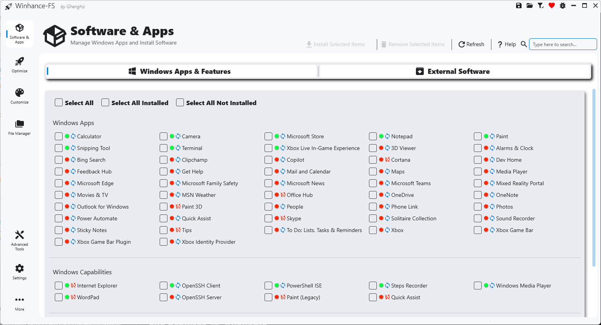 | 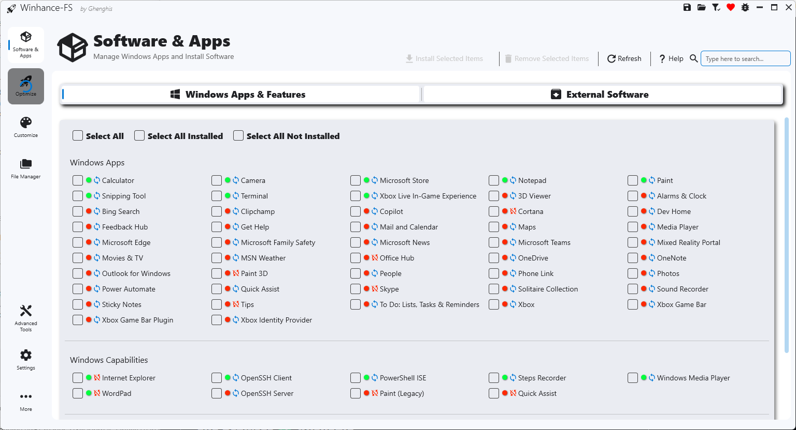 |
| **Customize** | **Settings** |
| 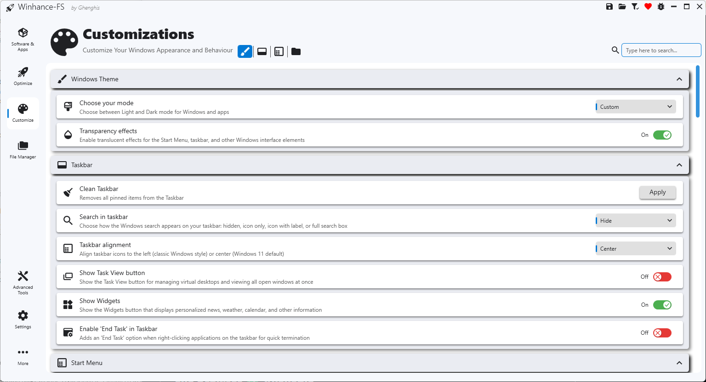 | 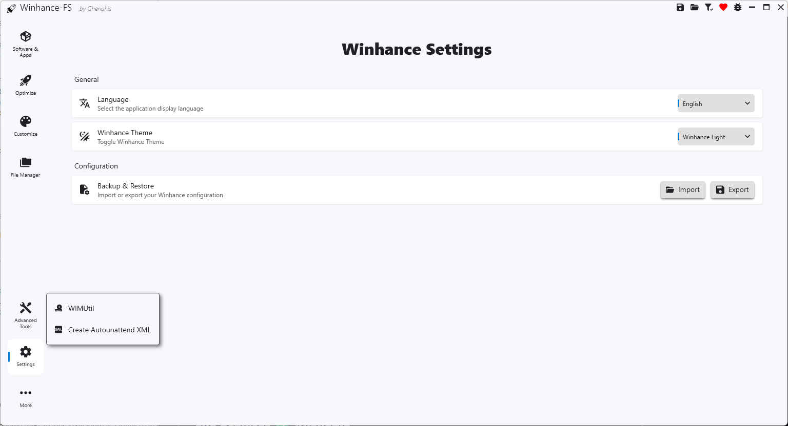 |

### New: File Manager

| File Browser — dual pane, copy/move between panes | Right-click menu |
|:---:|:---:|
| 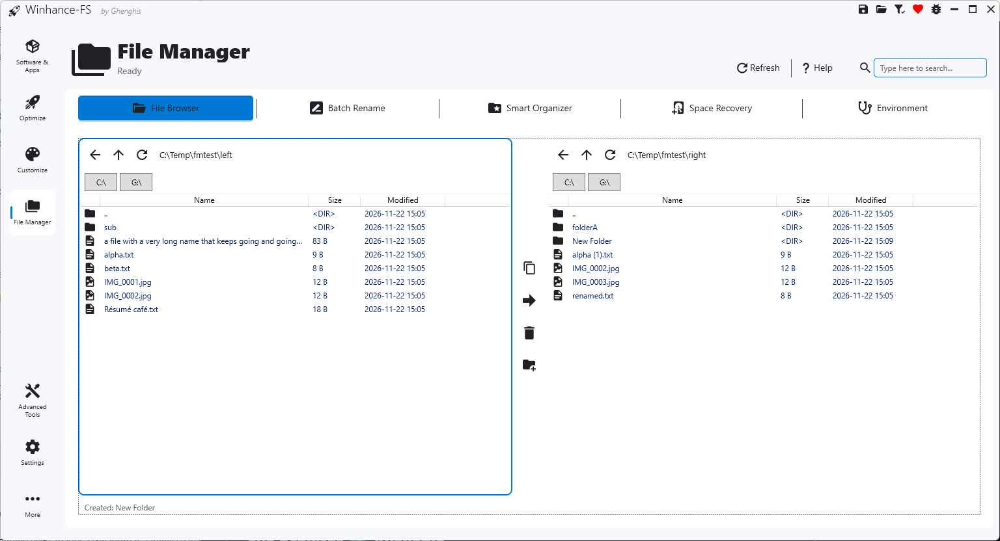 | 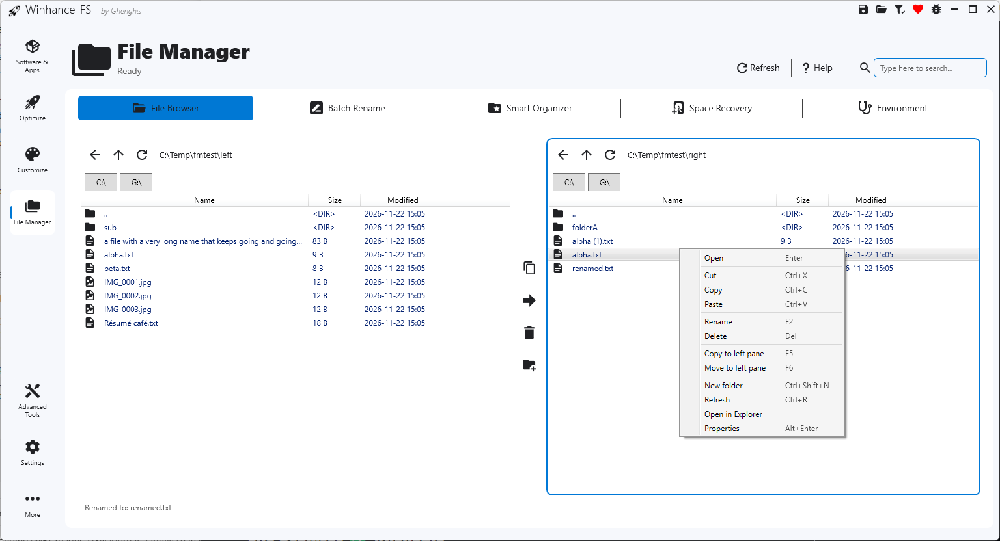 |
| **Rename validation (invalid names rejected)** | **Delete asks first and uses the Recycle Bin** |
| 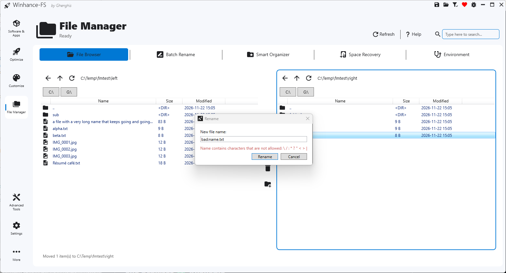 | 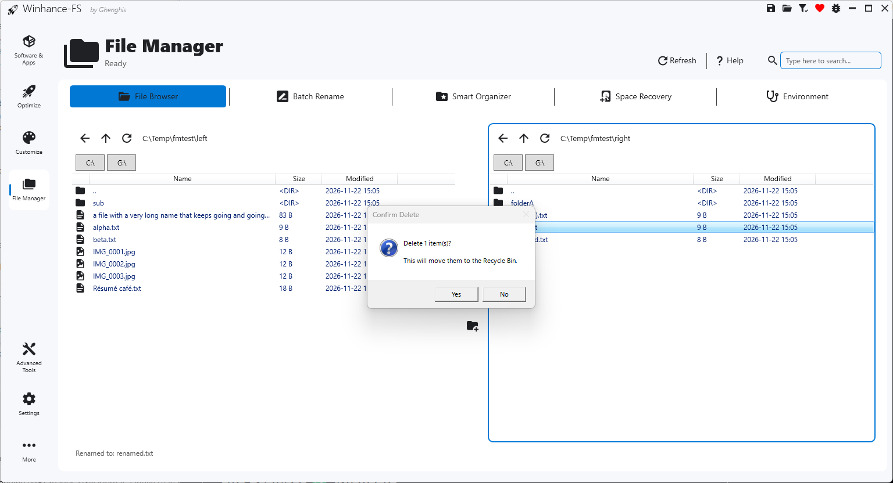 |
| **Batch Rename — live preview** | **Batch Rename — regex rule** |
|  | 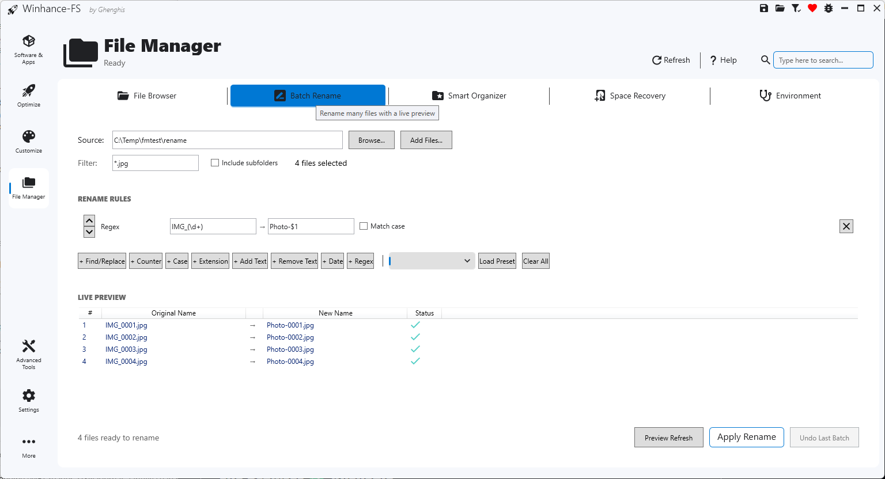 |
| **Smart Organizer — preview before moving** | **Smart Organizer — strategies** |
| 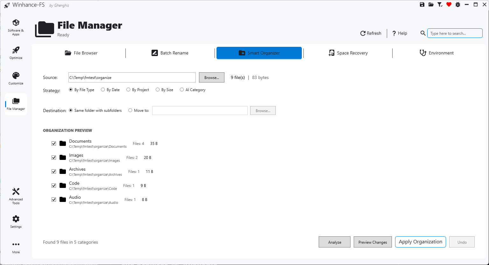 | 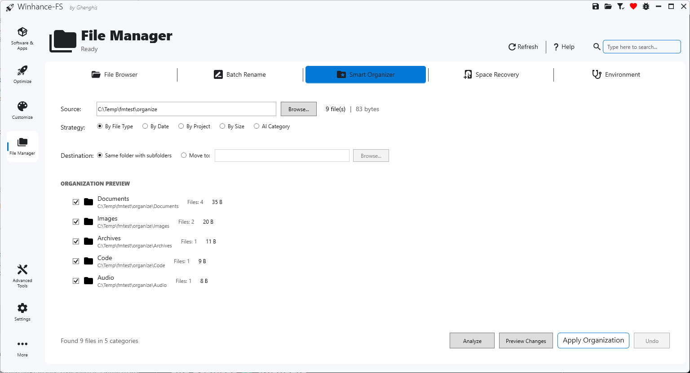 |
| **Space Recovery — treemap, clean temp files, relocate AI models** | |
| 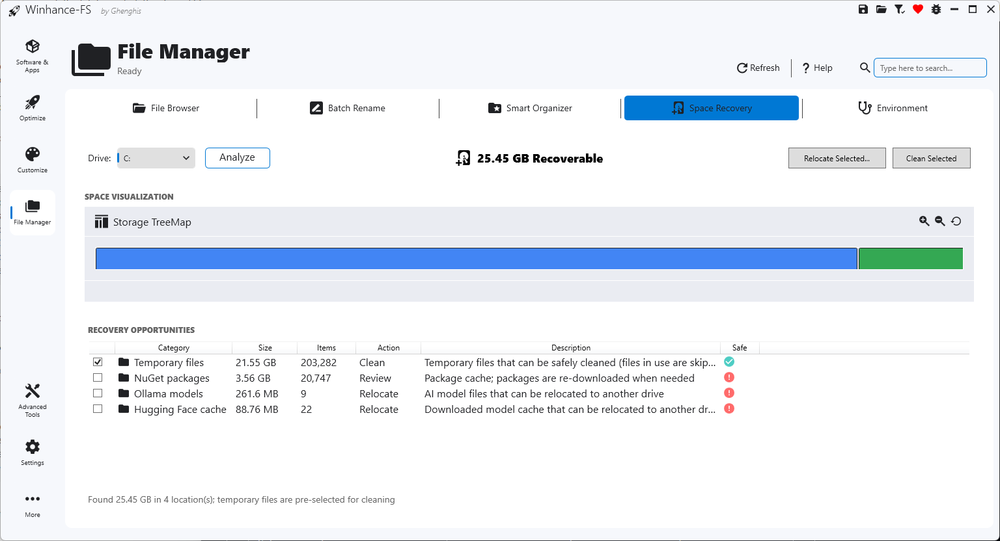 | |

### New: Environment Doctor (environment variables and PATH)

| Problems — severity, scope, proposed fix | Repair preview — backed up, verified, auto-rollback |
|:---:|:---:|
| 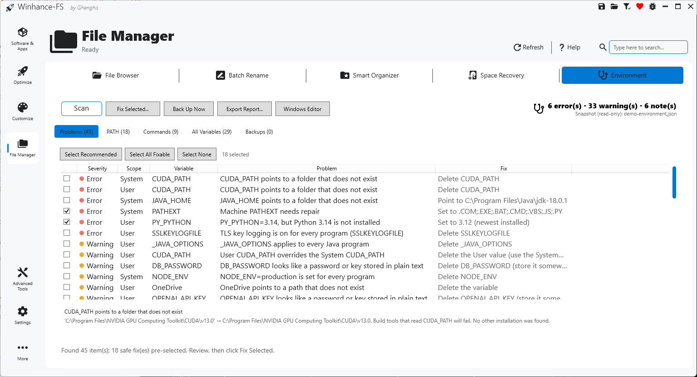 | 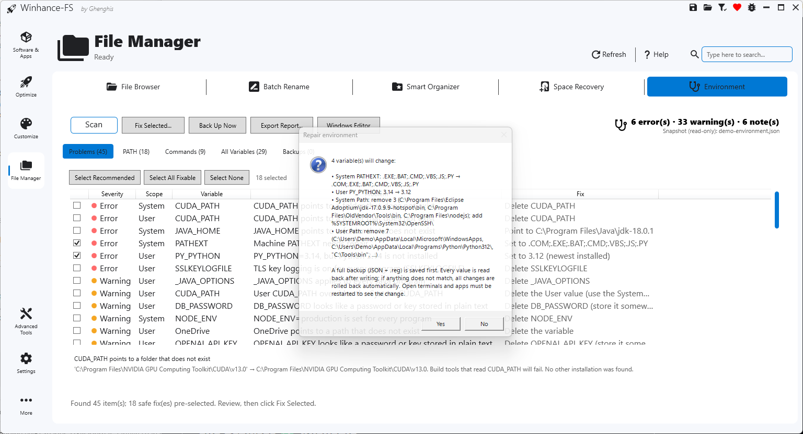 |
| **PATH — every entry with status** | **Command conflicts — which copy runs** |
| 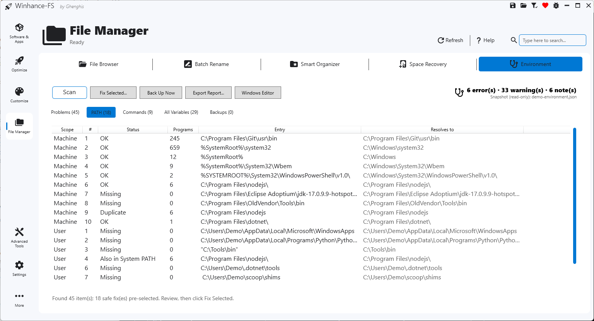 | 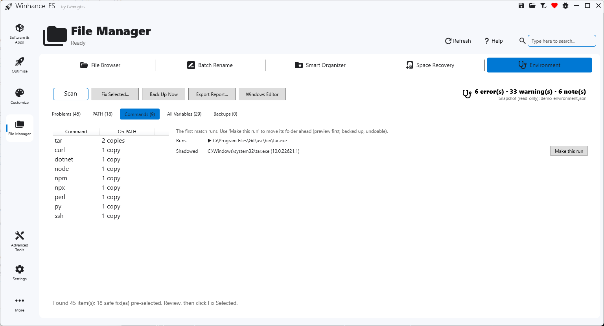 |
| **All variables — secrets always hidden** | **Backups — restore any point** |
| 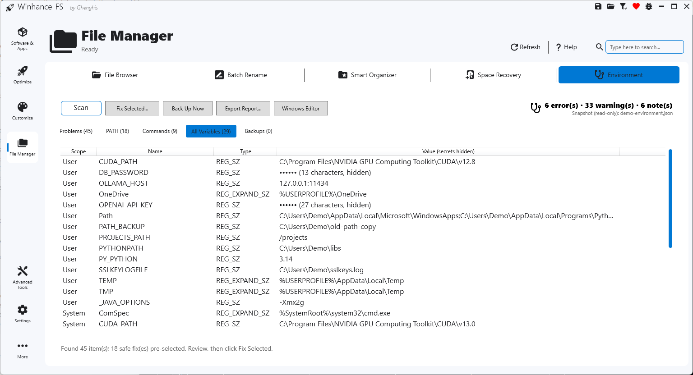 | 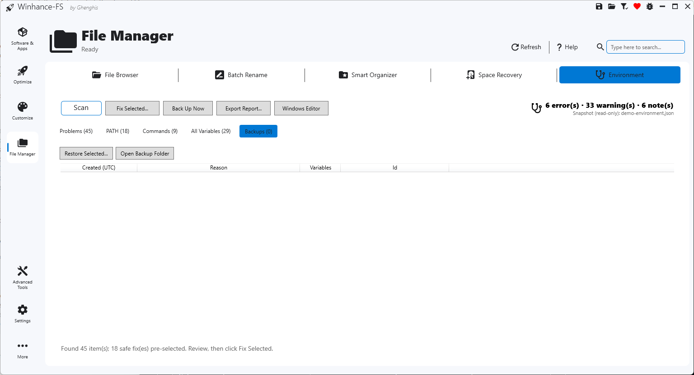 |

---

## What's different from stock Winhance

| Area | Stock Winhance | Winhance-FS |
|------|----------------|-------------|
| **File Manager section** | — | New: File Browser, Batch Rename, Smart Organizer, Space Recovery, Environment Doctor |
| Dual-pane browser | — | F5/F6 copy/move between panes, Explorer-compatible cut/copy/paste, F2 rename with validation, Recycle Bin delete, right-click menu |
| Batch rename | — | 8 rule types, live preview, conflict detection, undo of the last batch |
| Folder organizer | — | By type / date / project / size / AI category, preview before moving, undo |
| Space recovery | — | Finds temp files, AI model folders (LM Studio, Ollama, Hugging Face) and package caches; cleans old temp files; **relocates model folders to another drive** and leaves a link so the apps keep working |
| Environment variables / PATH | — | Environment Doctor: detects 45 kinds of problems, command conflicts and runtime homes; previewed repairs with backup, verification and automatic rollback |
| Updates | Checks memstechtips/Winhance | Checks this repository's releases; version history and rollback |
| Native and AI tooling | — | Rust `nexus_core` (MFT/USN indexing), Python MCP server, CLI and AI agents (separate components, not used by the app UI yet) |
| Software & Apps, Optimize, Customize, Advanced Tools | ✔ | Unchanged from upstream apart from small fixes |

---

## Requirements

- Windows 10 or 11, x64
- [.NET 9 Desktop Runtime](https://dotnet.microsoft.com/download/dotnet/9.0) for the framework-dependent
  portable zip (the self-contained builds include it)
- Administrator rights (Winhance asks on start, as stock Winhance does)

---

## Installation

Download from [GitHub Releases](https://github.com/Ghenghis/Winhance-FS/releases):

| File | What it is |
|------|------------|
| `Winhance-FS-Setup-vX.Y.Z.exe` | Installer with Start Menu entry and uninstaller |
| `Winhance-x64-Portable-vX.Y.Z.zip` | Self-contained portable — unzip and run `Winhance.exe` |
| `Winhance-x64-FrameworkDependent-Portable-vX.Y.Z.zip` | Smaller portable; needs the .NET 9 Desktop Runtime |

Each file has a `.sha256` next to it. Check a download with:

```powershell
(Get-FileHash .\Winhance-x64-Portable-vX.Y.Z.zip -Algorithm SHA256).Hash
```

To build it yourself: `dotnet build Winhance.sln`, or `scripts/release.ps1 -Version X.Y.Z` for a portable zip
in `artifacts/release/`.

> **Note:** This project is in active development. See [CHANGELOG.md](CHANGELOG.md) for what changed in each
> release.

---

## Credits and support

Winhance-FS is built on [Winhance](https://github.com/memstechtips/Winhance) by **memstechtips**. If stock
Winhance is useful to you, please support its developer:

[](https://ko-fi.com/memstechtips)
[](https://paypal.me/memstech)

---

## Features Overview

| Status | Meaning |
|--------|---------|
| ✅ **Available** | In the app, end-to-end tested |
| ⚠️ **Backend only** | Implemented in the backend or CLI; no UI in the app yet |
| 🚧 **Planned** | Not implemented yet |

| Area | Status |
|------|--------|
| [File Browser](#file-browser--available) | ✅ Available |
| [Batch Rename](#batch-rename--available) | ✅ Available |
| [Smart Organizer](#smart-organizer--available) | ✅ Available |
| [Space Recovery](#space-recovery--available) | ✅ Available |
| [Environment Doctor](#environment-doctor--available) (environment variables and PATH) | ✅ Available |
| [Undo / transaction log](#undo-and-safety) | ✅ Available (rename and organize) |
| Duplicate Finder | ⚠️ Backend only (`IDuplicateFinderService`) |
| [AI model relocation](#space-recovery--available) | ✅ Available (Space Recovery → Relocate Selected) |
| Rust deep-scan engine (MFT reader, USN journal, Tantivy search) | ⚠️ Backend only (`src/nexus_core`) |
| MCP server for AI assistants | ⚠️ Separate Python component (`src/nexus_mcp`) |
| Forensics tools (ADS, shadow copies, entropy, undelete) | 🚧 Planned |

---

## File Browser ✅ Available

A dual-pane browser in the **File Manager** section of Winhance.

| Action | How |
|--------|-----|
| Open file / enter folder | Double-click or **Enter** |
| Go up / back | **Backspace**, or the ↑ and ← buttons |
| Copy / move selection to the other pane | **F5** / **F6** |
| Cut, copy, paste | **Ctrl+X**, **Ctrl+C**, **Ctrl+V** (works with Windows Explorer in both directions) |
| Rename | **F2** (invalid names are rejected before anything changes) |
| Delete | **Del** — asks first and sends items to the Recycle Bin |
| New folder | **Ctrl+Shift+N** |
| Refresh | **Ctrl+R** |
| Properties | **Alt+Enter** |
| Everything above | Right-click menu |

Multi-select with **Ctrl**/**Shift**. Name conflicts never overwrite: a copy becomes `name (1).ext`.
Pasting a folder into itself is refused, and moving a folder to another drive copies first and removes the
source only after the copy completes.

---

## Batch Rename ✅ Available

Rename many files at once with a live preview that updates as you type.

| Rule | Options |
|------|---------|
| Find & Replace | Plain text or regular expression, match case |
| Add Text | Prefix, suffix or at a character index |
| Remove Text | Remove every match of a regular expression |
| Counter | Start, step, digits, separator, prefix or suffix |
| Change Case | lower, UPPER, Title, Sentence, tOGGLE |
| Change Extension | New extension for every file |
| Date | File modified, file created or current date, any .NET date format |
| Regex | Pattern → replacement |

Rules apply in order and can be reordered. Conflicts are flagged in the preview before anything is renamed,
and **Undo Last Batch** restores the original names.

---

## Smart Organizer ✅ Available

Sorts a folder's files into category subfolders.

- **Strategies:** by file type, date, project, size or AI category
- **Preview first:** Analyze shows every category, file count and destination before anything moves
- **Destination:** subfolders in the same folder, or **Move to** another folder
- **Undo:** restores every file and removes the folders it created

---

## Space Recovery ✅ Available

Finds space you can get back on a drive:

| Location | Action |
|----------|--------|
| Windows temporary files | **Clean** — files older than 24 hours, skipping files in use, after confirmation |
| LM Studio, Ollama and Hugging Face model folders | **Relocate Selected** — moves one folder to a drive you pick (checks free space, copies and verifies before removing the original) and leaves a link at the old path |
| NuGet, Cargo, npm and pip package caches | **Review** — reported only, never deleted by the app |

Results show size and file count for each location, plus a treemap.

---

## Environment Doctor ✅ Available

The **Environment** tab in File Manager diagnoses and repairs Windows environment variables and PATH, for
the current user and the whole system. Scanning is read-only; nothing changes until you review the
fixes and choose **Fix Selected**.

| Area | What it finds |
|------|---------------|
| **PATH** (User and System) | Folders that no longer exist, duplicates (including `%VAR%` vs expanded forms and User copies of System entries), quotes, stray spaces, empty `;;` entries, relative paths, files listed as folders, undefined `%VARIABLES%`, folders with no programs, user-writable folders in the System PATH, missing essential Windows folders (`system32`, `Wbem`, PowerShell, OpenSSH), length over legacy limits |
| **Registry type** | Values with `%VARIABLES%` stored as `REG_SZ`, so Windows never expands them (a classic cause of "command not found") |
| **Command conflicts** | Which copy of `python`, `node`, `java`, `git`, `dotnet`, `go`, `cargo` and 20 more actually runs, every shadowed copy with its version, the Microsoft Store `python` alias hiding a real install, Windows commands (`find`, `sort`, `curl`, `tar`, `ssh`) shadowed by Git/MSYS/conda tools. **Make this run** moves the folder you choose ahead. |
| **Runtime homes** | `JAVA_HOME`, `JDK_HOME`, `GOROOT`, `ANDROID_HOME`/`ANDROID_SDK_ROOT`, `CUDA_PATH`, `DOTNET_ROOT`, `MAVEN_HOME`, `GRADLE_HOME`, `NVM_*` and more: missing folder, pointing at `in`, invalid layout, a different install than the one on PATH, with a suggested replacement found on disk |
| **Developer pitfalls** | Global `PYTHONHOME`/`PYTHONPATH`, `NODE_ENV`, `_JAVA_OPTIONS`/`JAVA_TOOL_OPTIONS`, `PY_PYTHON` naming a Python that is not installed, conda folders on the global PATH, conflicting SDK pairs (`CUDA_PATH` vs `CUDA_HOME` …), User values overriding System ones, manual `PATH_BACKUP` copies, Linux-style `/paths` |
| **Core variables** | `ComSpec`, `windir`, `OS`, `PATHEXT` (missing `.EXE` etc.), `PSModulePath`, `TEMP`/`TMP` missing or not writable |
| **Security** | `SSLKEYLOGFILE` (TLS keys written to disk), passwords, tokens and API keys stored as plain variables (values are always hidden in the app and in reports) |

**Repairs are safe by construction:** only unambiguous fixes are pre-selected; every fix is previewed; a full
backup (JSON + double-clickable `.reg`) is saved first; the plan refuses anything that would empty the System
PATH, drop `system32`, delete core variables or exceed Windows limits; if another program changed a value since
the scan, nothing is written; every value is read back after writing and **all changes roll back
automatically** on any mismatch; running programs are notified (`WM_SETTINGCHANGE`). Any backup can be restored
from the **Backups** section, and a restore is itself backed up. **Export Report** saves a shareable text report
with secrets hidden.

---

## Undo and safety

- Batch rename and organize operations are recorded and can be undone from the app.
- Deletes go to the Recycle Bin; nothing is permanently deleted without a confirmation that says so.
- The clipboard follows the Windows convention (copy vs. move), so files cut or copied in Explorer
  behave the same when pasted into Winhance, and vice versa.

---

## Architecture

```
┌─────────────────────────────────────────────────────────────────────────────────┐
│                           WINHANCE-FS ARCHITECTURE                              │
├─────────────────────────────────────────────────────────────────────────────────┤
│                                                                                 │
│  ┌─────────────────────────────────────────────────────────────────────────┐    │
│  │  PRESENTATION LAYER (C# WPF)                                            │    │
│  │  ├── File Manager Views                                                  │    │
│  │  ├── Batch Rename UI                                                     │    │
│  │  ├── Smart Organizer                                                     │    │
│  │  └── Settings & Configuration                                            │    │
│  └─────────────────────────────────────────────────────────────────────────┘    │
│                                    │                                            │
│                                    ▼                                            │
│  ┌─────────────────────────────────────────────────────────────────────────┐    │
│  │  SERVICE LAYER (C# Infrastructure)                                       │    │
│  │  ├── FileManagerService                                                  │    │
│  │  ├── BatchRenameService                                                  │    │
│  │  ├── OrganizerService                                                    │    │
│  │  ├── DuplicateFinderService                                              │    │
│  │  └── NexusIndexerService (Rust Interop)                                  │    │
│  └─────────────────────────────────────────────────────────────────────────┘    │
│                                    │                                            │
│                                    ▼                                            │
│  ┌─────────────────────────────────────────────────────────────────────────┐    │
│  │  DOMAIN LAYER (C# Core)                                                  │    │
│  │  ├── Interfaces (IFileManagerService, etc.)                              │    │
│  │  ├── Models (FileEntry, DuplicateGroup, etc.)                            │    │
│  │  └── Events (FileOperationEvent, etc.)                                   │    │
│  └─────────────────────────────────────────────────────────────────────────┘    │
│                                    │                                            │
│                                    ▼                                            │
│  ┌─────────────────────────────────────────────────────────────────────────┐    │
│  │  NATIVE LAYER (Rust nexus_core)                                          │    │
│  │  ├── MFT Reader (mft_reader.rs)                                          │    │
│  │  ├── USN Journal (usn_journal.rs)                                        │    │
│  │  ├── Tantivy Search (tantivy_engine.rs)                                  │    │
│  │  └── FFI Bindings (ffi/mod.rs)                                           │    │
│  └─────────────────────────────────────────────────────────────────────────┘    │
│                                    │                                            │
│                                    ▼                                            │
│  ┌─────────────────────────────────────────────────────────────────────────┐    │
│  │  AI TOOLS LAYER (Python)                                                 │    │
│  │  ├── nexus_mcp (MCP Server)                                              │    │
│  │  ├── nexus_ai (ML Tools)                                                 │    │
│  │  └── nexus_cli (Command Line)                                            │    │
│  └─────────────────────────────────────────────────────────────────────────┘    │
│                                                                                 │
└─────────────────────────────────────────────────────────────────────────────────┘
```

---

## Project Structure

```
Winhance-FS-Repo/
├── src/
│   ├── Winhance.Core/           # C# Domain layer (interfaces, models)
│   ├── Winhance.Infrastructure/ # C# Service layer
│   ├── Winhance.WPF/            # C# WPF Presentation layer
│   ├── nexus_core/              # Rust performance backend
│   │   ├── src/indexer/         # MFT, USN Journal
│   │   ├── src/search/          # Tantivy engine
│   │   └── src/ffi/             # C# interop
│   ├── nexus_ai/                # Python AI tools
│   ├── nexus_cli/               # Python CLI
│   └── nexus_mcp/               # Python MCP server
├── docs/                        # Documentation
├── scripts/                     # Utility scripts
└── .github/workflows/           # CI/CD pipelines
```

---

## Documentation

### User Guides
- [Features Overview](docs/FEATURES.md)
- [File Manager Guide](docs/FILE_MANAGER.md)
- [Batch Rename System](docs/BATCH_RENAME.md)
- [Smart Organizer](docs/FILE_ORGANIZER.md)
- [Theming Guide](docs/THEMING.md)

### Developer Guides
- [Architecture Guide](docs/ARCHITECTURE.md)
- [Development Setup](docs/DEVELOPMENT.md)
- [Rust Backend](docs/RUST_BACKEND.md)
- [Contributing](CONTRIBUTING.md)

---

## Feedback and Community

If you have feedback, suggestions, or need help with Winhance-FS, please join the discussion:

[](https://github.com/Ghenghis/Winhance-FS/discussions)
[](https://www.discord.gg/zWGANV8QAX)

---

## License

This project is licensed under the MIT License - see the [LICENSE](LICENSE.txt) file for details.

---

<p align="center">
  <i>Built with ❤️ as an extension to <a href="https://github.com/memstechtips/Winhance">Winhance</a></i>
</p>
